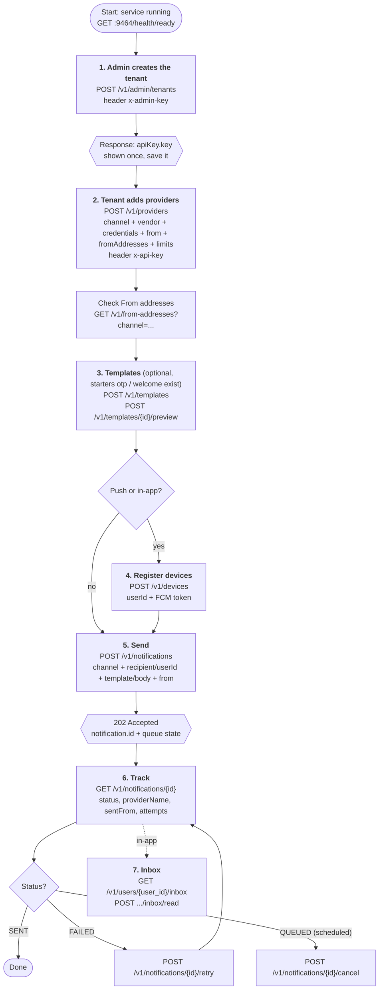
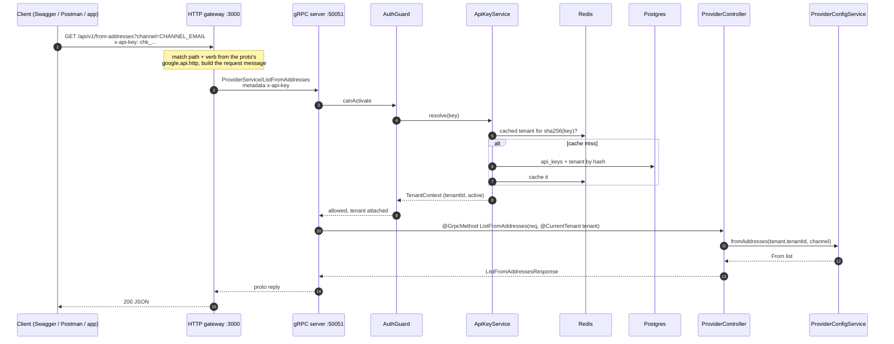
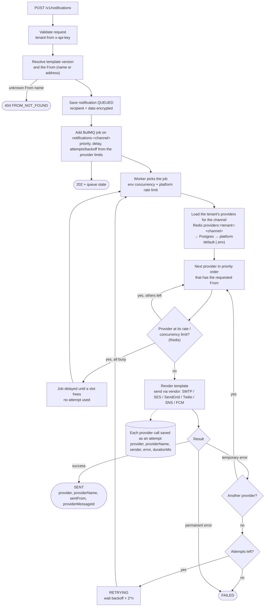
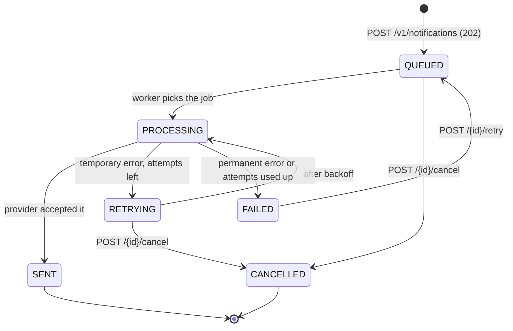
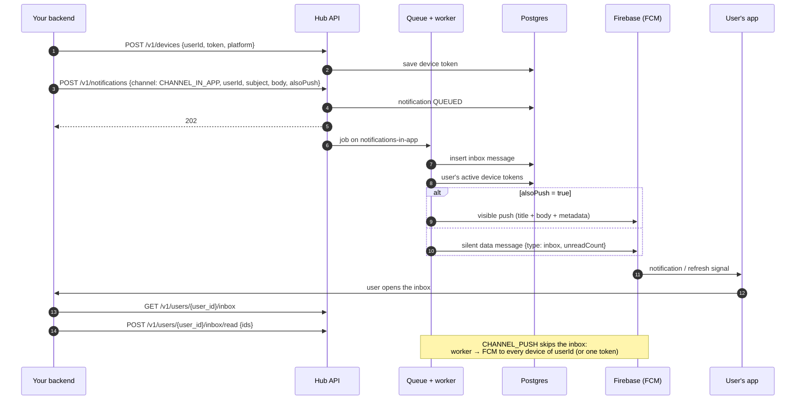

# Communication Hub: flow diagrams

The same diagrams as editable draw.io pages: [communication-hub-flows.drawio](communication-hub-flows.drawio).
Endpoints and request bodies for every step: [../http/](../http/) and [../API_GUIDE.md](../API_GUIDE.md).

1. [Setup and send, step by step](#1-setup-and-send-step-by-step)
2. [How one API call reaches the business logic](#2-how-one-api-call-reaches-the-business-logic)
3. [Delivery: queue, provider, failover, retry](#3-delivery-queue-provider-failover-retry)
4. [Notification status](#4-notification-status)
5. [In-app and push](#5-in-app-and-push)

## 1. Setup and send, step by step

Which API to call first, and what comes next.

## 2. How one API call reaches the business logic

There is no tenantId field in tenant APIs (for example `ListFromAddresses`): the tenant comes from the
`x-api-key` header. The guard resolves the key to its tenant, and the controller gets it as
`@CurrentTenant()`.

A gRPC client skips the gateway and calls `:50051` directly with the same metadata.

## 3. Delivery: queue, provider, failover, retry

## 4. Notification status

## 5. In-app and push

